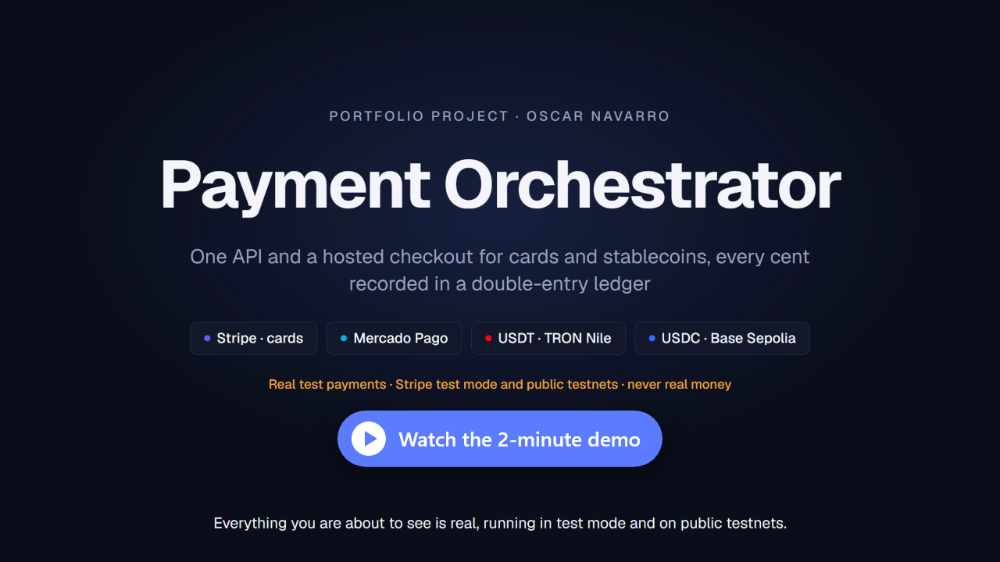
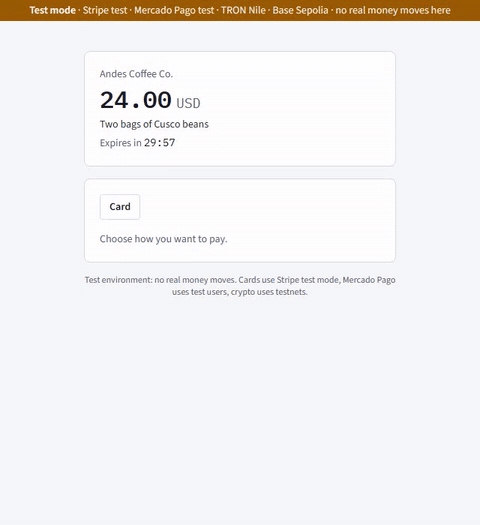
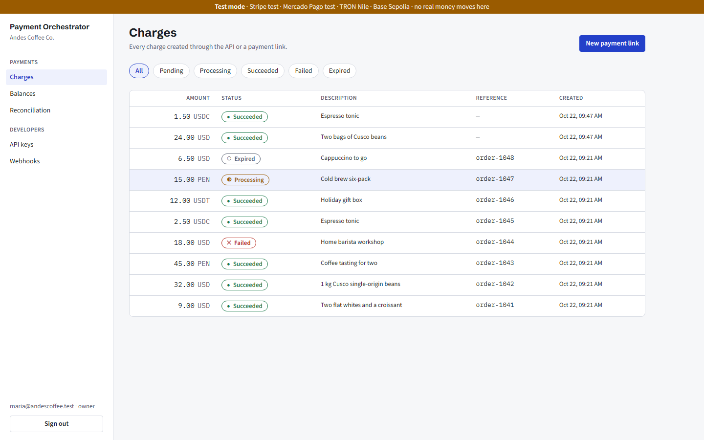
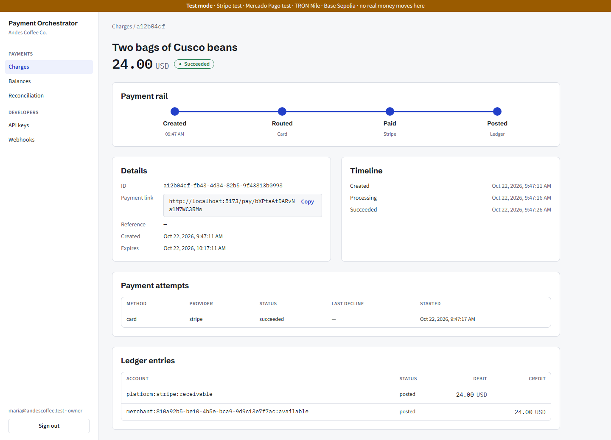
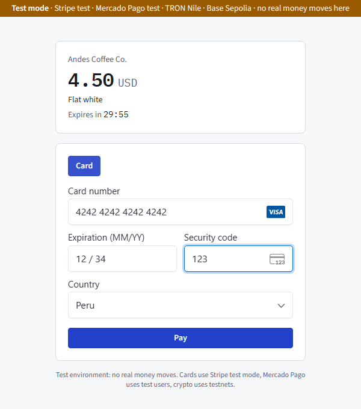
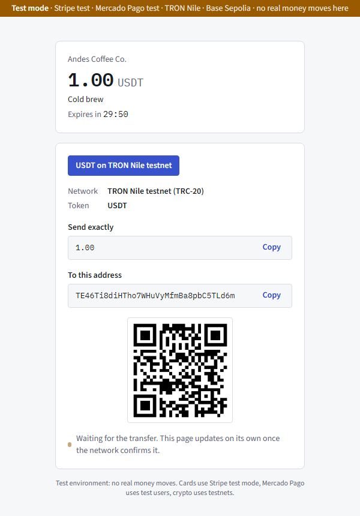
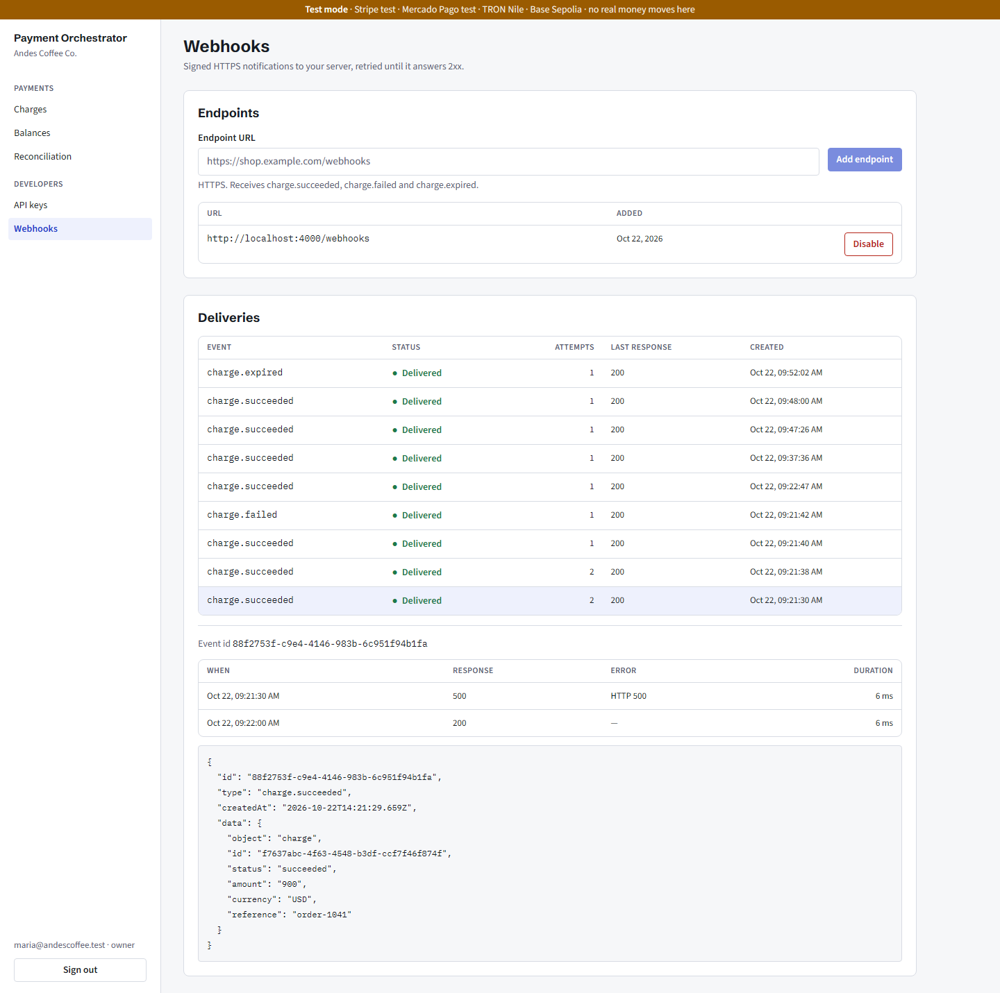
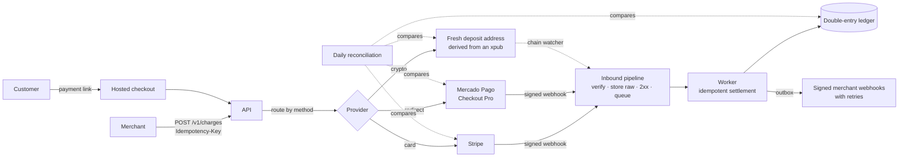

# Payment Orchestrator

[](https://github.com/oscardanielnc/payment-orchestrator/actions/workflows/ci.yml)
[](LICENSE)


One API and a hosted payment link for merchants. A payment is routed to **Stripe** (cards),
**Mercado Pago**, **USDT on TRON** or **USDC on Base**, confirmed by webhook or on-chain, and
recorded in a **double-entry ledger**. A daily job reconciles every provider against that ledger.

[](https://oscarnavarro.dev/walkthroughs/payment-orchestrator.mp4)

<p align="center">
  
</p>

**Test mode and testnets only.** The app refuses to start with live keys or a mainnet network, and
mainnets are not even representable in its types.

## Verified on real test networks

| Rail                     | Evidence                                                                                                                                                                                                                  |
| ------------------------ | ------------------------------------------------------------------------------------------------------------------------------------------------------------------------------------------------------------------------- |
| Card, Stripe test mode   | Approved, declined then retried, and canceled payments; lost webhooks covered by a status check                                                                                                                           |
| Mercado Pago, test users | Four approved Checkout Pro payments; while the notifications were being rejected, the status check settled all four, and reconciliation matched 4 of 4                                                                    |
| USDT TRC-20, TRON Nile   | [1 USDT payment](https://nile.tronscan.org/#/transaction/e99ab52f660356e77dab9f7898118f792a725ad282966833085a0c730ab5c994), paid about 70 s after sending (block solidified)                                              |
| USDC, Base Sepolia       | [1 USDC payment](https://sepolia.basescan.org/tx/0x2ce2a60279b731a27c710966c39c0a141075c8866bf41bdc413e60f2bc3eaae0), paid 37 s after sending (12 confirmations)                                                          |
| Reconciliation           | A [transfer the watcher had not read](https://sepolia.basescan.org/tx/0xe63159baf9677eab7cd1c5564f0d82e23169dc26633f4ab43aeb99c77bd5f12d) opened an `amount_mismatch` finding, which cleared once the watcher recorded it |

## Screenshots

All taken from the running app in test mode. The merchant is a demo coffee shop.

| Merchant dashboard                                                                                         | Charge timeline and its ledger postings                                                                                  |
| ---------------------------------------------------------------------------------------------------------- | ------------------------------------------------------------------------------------------------------------------------ |
|  |  |
| **Hosted checkout: card**                                                                                  | **Hosted checkout: USDT on TRON Nile**                                                                                   |
|                          |                                  |



## How a payment flows



## Engineering highlights

| Problem                                     | Approach                                                                                                                                                                                                                     |
| ------------------------------------------- | ---------------------------------------------------------------------------------------------------------------------------------------------------------------------------------------------------------------------------- |
| A retried request must not charge twice     | `Idempotency-Key` stored in Postgres; webhooks and chain events deduplicated by provider id ([ADR 0007](docs/adr/0007-idempotency.md))                                                                                       |
| State and money must change together        | Charge, attempt and ledger posting in one unit of work; events leave through a transactional outbox ([ADR 0004](docs/adr/0004-unit-of-work.md), [0008](docs/adr/0008-outbox-and-queues.md))                                  |
| Balances must be explainable                | Append-only double-entry ledger; balances are sums, never stored; Postgres triggers refuse edits ([ADR 0009](docs/adr/0009-ledger.md))                                                                                       |
| Crypto without an intermediary              | One address per attempt from an xpub (the server cannot spend); own watchers for TRON and EVM behind one port ([ADR 0010](docs/adr/0010-crypto-deposits.md), [0020](docs/adr/0020-base-confirmations-and-evm-watcher.md))    |
| Lost confirmations                          | Three nets: webhooks, a status check for silent payments, and daily reconciliation that never moves money by itself ([ADR 0019](docs/adr/0019-status-check-for-missed-webhooks.md), [0021](docs/adr/0021-reconciliation.md)) |
| Notifying merchants safely                  | HMAC-signed webhooks with timestamp, exponential retries, AES-GCM encrypted secrets, SSRF guards ([ADR 0018](docs/adr/0018-outbound-webhooks.md))                                                                            |
| Never touching real money                   | An environment guard that fails closed on live keys, mainnet hosts or foreign token contracts ([ADR 0006](docs/adr/0006-environment-policy.md))                                                                              |
| Adding a provider without touching the core | Hexagonal modules with abstract-class ports; routing is a data table, not `if`s. Base was two adapters and config ([ADR 0002](docs/adr/0002-hexagonal-modules.md), [0015](docs/adr/0015-payment-providers-and-routing.md))   |

23 architecture decisions, including the discarded options, live in [docs/adr](docs/adr/README.md).

## Features

| Feature                                                                | Status |
| ---------------------------------------------------------------------- | ------ |
| Charges API with a state machine, idempotency and keyset pagination    | Done   |
| Dashboard sign-in with rotating refresh tokens, owner and member roles | Done   |
| Cards through Stripe test mode                                         | Done   |
| USDT on TRON Nile, USDC on Base Sepolia                                | Done   |
| Payment links with a hosted checkout                                   | Done   |
| Signed outbound webhooks with retries                                  | Done   |
| Daily reconciliation with findings                                     | Done   |
| Mercado Pago Checkout Pro, test users only                             | Done   |

Specs and acceptance criteria: [docs/product/features](docs/product/features/README.md).

## Stack

**API:** NestJS 11, Prisma 7 on Postgres, BullMQ on Redis, Zod contracts, Stripe and Mercado Pago SDKs,
viem, TronWeb.
**Web:** React 19, Vite, React Router, TanStack Query, Zustand, Tailwind 4, Storybook.
**Quality:** Vitest unit and e2e tests (Testcontainers Postgres), ESLint with module boundaries,
gitleaks on every commit and in CI. Turborepo + pnpm monorepo.

## Run it

Requirements: Node 24, pnpm, Docker.

```sh
pnpm install
cp .env.example .env                              # test keys and testnet values only
docker compose up -d
pnpm --filter @po/api db:deploy                   # apply migrations
pnpm --filter @po/api org:create "Acme Coffee"    # prints a test API key
pnpm dev                                          # API :3000/v1/health · dashboard :5173
```

`pnpm check` runs lint, typecheck, tests and build, the same as CI. E2E tests need Docker.
Runbooks for each rail (Stripe, Nile, Base, webhooks, reconciliation) are in [docs/runbooks](docs/runbooks/README.md).

## Layout

| Path                 | What                                                           |
| -------------------- | -------------------------------------------------------------- |
| `apps/api`           | NestJS API and worker (one codebase, two processes)            |
| `apps/web`           | Merchant dashboard and public checkout                         |
| `packages/ui`        | Design system with Storybook                                   |
| `packages/contracts` | Zod request/response contracts shared by API and web           |
| `packages/config`    | Shared TypeScript config                                       |
| `docs/`              | Vision, features, architecture, ADRs ([index](docs/README.md)) |

## License

[MIT](LICENSE) © 2026 Oscar Navarro
